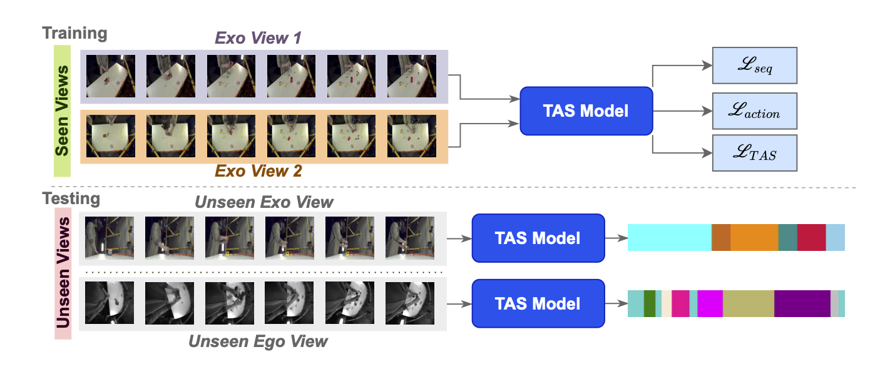

# Towards Generalizing Temporal Action Segmentation to Unseen Views

Official code for **"Towards Generalizing Temporal Action Segmentation to Unseen Views"**.
[[Paper (IJCV)]](https://link.springer.com/article/10.1007/s11263-025-02703-0) [[arXiv]](https://arxiv.org/abs/2504.02512)

<p align="center">

</p>

We address temporal action segmentation on **unseen camera views**: the views used for evaluation are not available during
training, e.g. a new exocentric view or an egocentric view. On top of the standard segmentation loss L_TAS, a Siamese
network with shared weights is trained with two losses:

* **sequence loss** L_seq (`MODEL.SEQUENCE_LOSS_WEIGHT`, λ): makes the frame-wise representations of two synchronized
  views of the same sequence similar;
* **action loss** L_action (`MODEL.ACTION_LOSS_WEIGHT`, β): makes the representations of two segments with the same action
  label from different views similar.

Both losses use the negative cosine similarity between the output of a predictor head (MLP) for one input and the
(stop-gradient) representation of the other input. The segmentation network is [LTContext](https://github.com/LTContext/LTContext).
The full objective is L = L_TAS + λ L_seq + β L_action.

## 1. Installation

Requirements: Linux, an NVIDIA GPU, and [conda](https://docs.conda.io/en/latest/miniconda.html) (or Python 3.9 with pip).
The code was tested with Python 3.9, PyTorch 2.0.0 and CUDA 11.7.

```bash
git clone https://github.com/emadRad/UnseenViewTAS.git
cd UnseenViewTAS

# option A: conda
conda env create -f environment.yml
conda activate uvtas

# option B: pip (inside a Python 3.9 virtual environment)
pip install -r requirements.txt
```

`requirements.txt` installs the CUDA 11.7 build of PyTorch. For another CUDA version, install `torch==2.0.0` and
`torchvision==0.15.1` following the [PyTorch instructions](https://pytorch.org/get-started/previous-versions/#v200)
first, then remove the two torch lines from `requirements.txt` and run `pip install -r requirements.txt`.

Check the installation:
```bash
python -c "import torch; print(torch.__version__, torch.cuda.is_available())"
```

## 2. Data

All commands must be run from the root of the repository: the annotations and splits in `data/` are loaded relative to
the working directory. The features are loaded from `DATA.PATH_TO_DATA_DIR`.

### 2.1 Annotations (`data/`)

| Dataset | Included in this repository | To download |
|---|---|---|
| [Assembly101](https://assembly101.github.io/) | train/val splits (`data/assembly101/{train,val}.csv`), coarse action labels (`data/assembly101/coarse-annotations/`) | `data/assembly101/fine-grained-annotations/train_segm_modified_l.csv` (see below) |
| [IKEA ASM](https://ikeaasm.github.io/) | frame-wise action labels (`data/ikea_asm/segm_anns_pv/`), class mapping | – |

The action loss on Assembly101 samples pairs of *fine-grained* action segments. They are read from
`data/assembly101/fine-grained-annotations/train_segm_modified_l.csv`, which is derived from the
fine-grained annotations of [Assembly101](https://assembly101.github.io/) and contains, for every
fine-grained segment, the video, view, start/end frame, action class, toy id, and the action type (assembly/disassembly)
with the start/end frame of the corresponding coarse segment.

Download [`train_segm_modified_l.csv`](https://drive.google.com/file/d/16SH7xAk4LfugBC4Tn16EGGuI77ZulYAk/view?usp=sharing) (110 MB)
and place it at `data/assembly101/fine-grained-annotations/train_segm_modified_l.csv`, e.g. with
[gdown](https://github.com/wkentaro/gdown):

```bash
pip install gdown
mkdir -p data/assembly101/fine-grained-annotations
gdown 16SH7xAk4LfugBC4Tn16EGGuI77ZulYAk -O data/assembly101/fine-grained-annotations/train_segm_modified_l.csv
md5sum data/assembly101/fine-grained-annotations/train_segm_modified_l.csv   # 6109d5b4d559eb492f88e9898fb9f4a1
```

### 2.2 Features (`DATA.PATH_TO_DATA_DIR`)

The models use pre-extracted frame-wise features, stored as float32 `.npy` files of shape `[T, D]`:

```
<DATA.PATH_TO_DATA_DIR>/features/<DATA.FEATURE_BACKBONE>/
    Assembly101:  <action_type>_<video_id>/<view>.npy       e.g. assembly_nusar-2021_action_both_9011-b06b_..._154253/C10095_rgb.npy
    IKEA ASM:     <furniture>/<video>/<view>.npy             e.g. Kallax_Shelf_Drawer/0001_black_table_02_01_2019_08_16_14_00/dev3.npy
```

For Assembly101, the features of a recording are stored separately for the assembly and disassembly part
(`video_start_frame`/`video_end_frame` in `data/assembly101/{train,val}.csv`) at 30 fps; the models sub-sample them by
`DATA.FRAME_SAMPLING_RATE`.

| Features | `DATA.FEATURE_BACKBONE` | `MODEL.INPUT_DIM` |
|---|---|---|
| DINOv2 ViT-L/14, frame-wise, not fine-tuned | `dinov2_vitl14_spatial` | 1024 |
| MViTv2-L (MaskFeat), fine-tuned on the seen views of Assembly101 | `mvit_tuned_assembly101_tempo_spatial_16x1_seen_views` | 1152 |

> **TODO (authors):** link the released features.

**Extracting DINOv2 features.** `tools/extract_dinov2_features.py` extracts frame-wise DINOv2 ViT-L/14 features of a video
(short side resized to 256, center crop 224, normalization with mean 0.45 / std 0.225) and stores them in the layout above.
It needs `git` to fetch a pinned commit of the DINOv2 repository (the weights are downloaded via `torch.hub`).

```bash
python tools/extract_dinov2_features.py \
    --video /path/to/assembly101/videos/<video_id>/C10095_rgb.mp4 \
    --out /path/to/assembly101/features/dinov2_vitl14_spatial/assembly_<video_id>/C10095_rgb.npy \
    --start-frame 2833 --end-frame 6959    # assembly part of the recording (video_start_frame, video_end_frame)
```

Our released features were extracted with a clip-based pipeline (16-frame clips) and are shifted by about 15 frames
compared to the output of this script; otherwise they agree (cosine similarity ~0.99 per frame).

## 3. Training

Every config trains our method (L_TAS + λ L_seq + β L_action) for one dataset and feature type:

| Config | Dataset | Features | λ | β |
|---|---|---|---|---|
| `configs/Assembly101/MViTv2L.yaml` | Assembly101 | MViTv2-L | 0.5 | 0.2 |
| `configs/Assembly101/DINOv2L.yaml` | Assembly101 | DINOv2-L | 1.0 | 1.0 |
| `configs/IkeaASM/DINOv2L.yaml` | IKEA ASM | DINOv2-L | 0.5 | 0.2 |

```bash
python run_net.py \
  --cfg configs/Assembly101/MViTv2L.yaml \
  DATA.PATH_TO_DATA_DIR /path/to/assembly101 \
  OUTPUT_DIR ./experiments
```

Any option of `uvtas/config/defaults.py` can be overridden on the command line as `KEY VALUE` pairs, e.g.
`MODEL.SEQUENCE_LOSS_WEIGHT 0.5 MODEL.ACTION_LOSS_WEIGHT 0.2 RNG_SEED 1`.

Notes:
* The model is evaluated on `TRAIN.EVAL_SPLIT` after every epoch. Each line `json_stats: {"_type": "val_epoch", ...}` of
  the log contains the metrics of the seen and unseen views (`seen/…`, `unseen/…` and, for Assembly101, `unseen_exo/…`
  and `unseen_ego/…`). F1 and MoF are in [0, 1], Edit in [0, 100].
* GPU memory: training on Assembly101 with `TRAIN.BATCH_SIZE 3` needs almost 48 GB (we used one RTX A6000). IKEA ASM
  needs less than 16 GB.
* Data loading is the bottleneck on Assembly101; increasing `DATA_LOADER.NUM_WORKERS` (default 2) speeds up training.
  The results do not depend on the number of workers in expectation, but bitwise reproducibility for a given
  `RNG_SEED` requires the same number of workers.

Outputs are written to `<OUTPUT_DIR>/<config name>/`:
```
checkpoints/<expr_num>/checkpoint_epoch_000XX.pyth, best_checkpoint.pyth
val_metrics/<expr_num>/epoch_XXX.csv     metrics per validation video and view
tb/<expr_num>/                           TensorBoard logs (tensorboard --logdir <OUTPUT_DIR>)
logs/                                    log files
```

## 4. Evaluation

```bash
python run_net.py \
  --cfg configs/Assembly101/MViTv2L.yaml \
  DATA.PATH_TO_DATA_DIR /path/to/assembly101 \
  TRAIN.ENABLE False \
  TEST.ENABLE True \
  TEST.CHECKPOINT_PATH /path/to/checkpoint.pyth \
  TEST.SAVE_RESULT_PATH ./results
```

The metrics are saved to `<TEST.SAVE_RESULT_PATH>/<dataset>/<config name>/<split>/`:
* `summary.csv`: mean F1@{10,25,50}, F1@Avg, Edit and MoF (accuracy) of the seen views, the unseen views and, for
  Assembly101, the unseen exocentric and egocentric views;
* `testing_metrics.csv`: the metrics of every video and view.

Add `TEST.SAVE_PREDICTIONS True` to also store the frame-wise predictions and ground truth.

> **TODO (authors):** add pretrained checkpoints.

## 5. Unseen-view protocols

| Dataset | Seen (training) views | Unseen views |
|---|---|---|
| Assembly101 | Exo1–Exo6 | Exo7 (`C10395_rgb`), Exo8 (`C10379_rgb`); Ego1–Ego4 (`HMC_*`) |
| IKEA ASM | `dev1`, `dev2` | `dev3` |

The unseen views are set by `DATA.UNSEEN_EXO_VIEWS` and `DATA.UNSEEN_EGO_VIEWS`. The names of the Assembly101 views
are listed in `uvtas/dataset/assembly101.py`.

## Citation

```bibtex
@article{bahrami2025unseenviews,
  title   = {Towards Generalizing Temporal Action Segmentation to Unseen Views},
  author  = {Bahrami, Emad and Zatsarynna, Olga and Francesca, Gianpiero and Gall, Juergen},
  journal = {International Journal of Computer Vision},
  year    = {2025},
  doi     = {10.1007/s11263-025-02703-0}
}
```

## Acknowledgement

This repository builds on [LTContext](https://github.com/LTContext/LTContext). The code structure is inspired by
[SlowFast](https://github.com/facebookresearch/SlowFast), the multi-head attention is based on
[xFormers](https://github.com/facebookresearch/xformers), and the evaluation code is taken from
[MS-TCN](https://github.com/yabufarha/ms-tcn).

## License

This work is licensed under a [Creative Commons Attribution-NonCommercial 4.0 International License](http://creativecommons.org/licenses/by-nc/4.0/).
